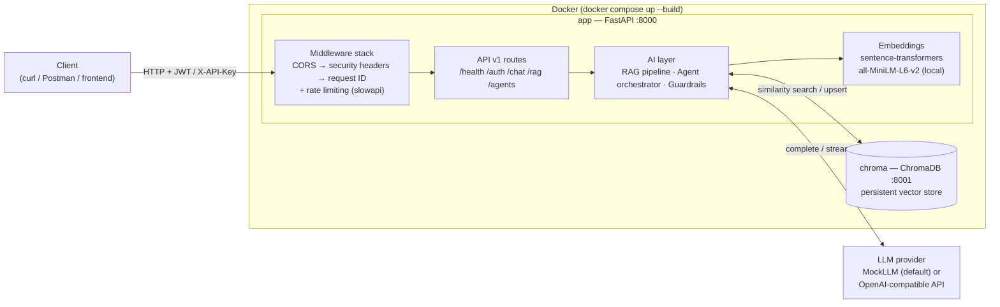
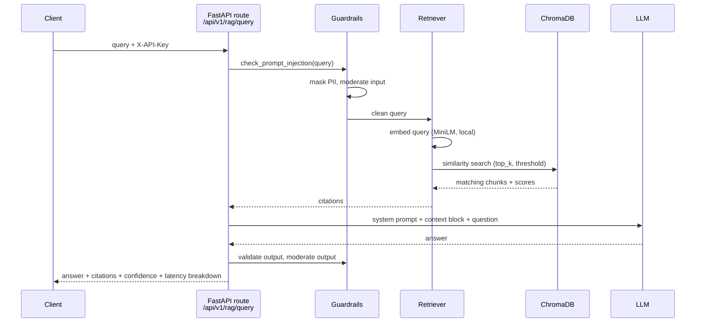
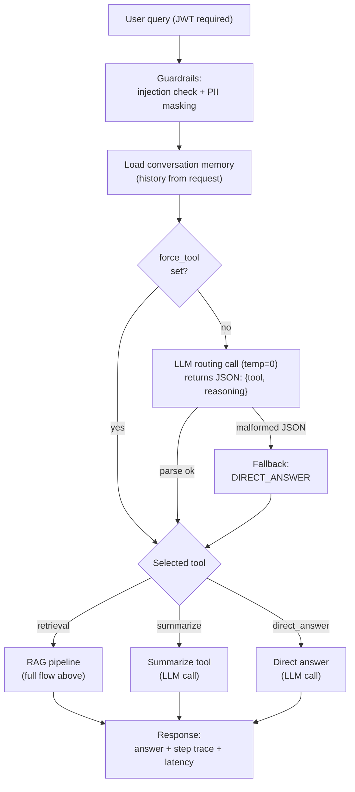
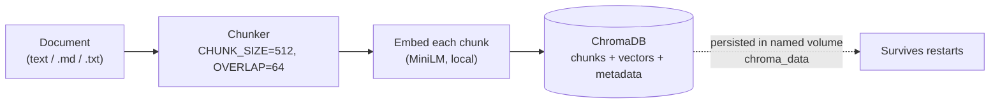

# Architecture

This document is the visual map of `ai_gen_platform` — a production-style GenAI backend
demonstrating a full RAG pipeline, an agent orchestrator, and enterprise security patterns
(JWT + API-key auth, rate limiting, guardrails, structured logging, cost telemetry).

For concept explanations see [CONCEPTS.md](CONCEPTS.md); for a guided tour of the code see
[LEARNING_GUIDE.md](LEARNING_GUIDE.md).

---

## System Overview

Two Docker services: the FastAPI app and ChromaDB (vector database). The LLM is either a
built-in mock (default, zero cost) or any OpenAI-compatible API.



**Key properties**

| Concern | Implementation |
|---|---|
| Web framework | FastAPI (app factory + lifespan), hot reload in Docker |
| Vector store | ChromaDB service (FAISS available as an alternative in `app/repositories/`) |
| Embeddings | `all-MiniLM-L6-v2` via sentence-transformers, computed **locally** (no API cost) |
| LLM | `BaseLLM` interface → `MockProvider` (default) or `OpenAICompatibleLLM` |
| Auth | JWT bearer (chat, agents) and `X-API-Key` (RAG endpoints) |
| Safety | Prompt-injection detection, PII masking, moderation hooks, output validation |
| Observability | Structured logs with request IDs, per-request latency headers, LLM cost tracker |

---

## Request Flow: RAG Query

`POST /api/v1/rag/query` runs the full pipeline in `app/ai/rag/pipeline.py`:



Steps in order: **guardrails → embed → retrieve → assemble context → LLM → cost tracking →
output validation → moderation → citations**. Retrieved context is injected into the *user*
message, not the system prompt, so the LLM treats it as information rather than instructions.

---

## Request Flow: Agent Run

`POST /api/v1/agents/run` uses an LLM-as-router pattern (`app/ai/agents/orchestrator.py`):
one LLM call decides the tool, then the tool executes. Simpler than ReAct, extendable to a
multi-step loop.



---

## Ingestion Flow

Documents enter the index via `POST /api/v1/rag/ingest` (raw text or a file under `data/`)
or `make ingest` (bulk-loads `data/sample_docs/`).



---

## Module Map

```
app/
├── main.py                  # App factory + lifespan (pre-warms embedding model)
├── api/
│   ├── router.py            # Aggregates v1 routes under /api/v1
│   └── v1/                  # health, auth, chat, rag, agents endpoints
├── ai/                      # The AI layer — provider-agnostic
│   ├── llm/                 # BaseLLM interface, mock + OpenAI-compatible providers
│   ├── embeddings/          # Sentence-transformers embedding provider
│   ├── rag/                 # pipeline, retriever, chunker, citation builder
│   ├── agents/              # orchestrator (LLM-as-router), tools, memory
│   ├── guardrails/          # injection, PII, moderation, output validation
│   ├── prompts/             # All prompt templates in one place
│   ├── telemetry/           # LLM cost tracking
│   └── evaluation/          # RAG eval + prompt regression harnesses
├── core/                    # config, logging, security, middleware, rate limiting
├── models/                  # Pydantic request/response schemas
├── repositories/            # Vector store abstraction: Chroma + FAISS implementations
├── services/                # chat / document / ingestion services
└── utils/                   # ids, text, time helpers
```

**Swap points** (interfaces over implementations):

- **LLM** — implement `BaseLLM` in `app/ai/llm/`, wire it in `app/api/v1/_providers.py`.
- **Vector store** — `app/repositories/vector_store.py` defines the interface; Chroma and
  FAISS both implement it.
- **Moderation** — `app/ai/guardrails/moderation.py` is a stub ready for a real moderation API.
